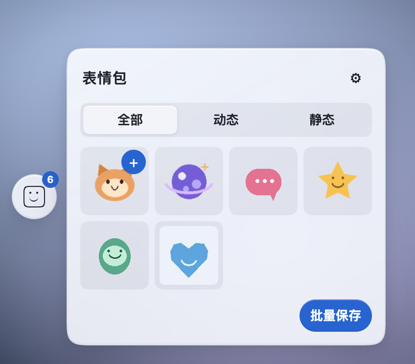

# Douyin Emoji Saver

[简体中文](README.zh-CN.md)

A Tampermonkey userscript for saving stickers that Douyin has already displayed in comments and direct messages. Version **5.1.0** has a movable floating button and a compact sticker picker. The interface is in Simplified Chinese.

*The screenshots show the release script running in an isolated Chrome demo with original sample stickers.*

[Preview screenshot](assets/sticker-preview.png)

## What it does

- Previews stickers in a grid and filters them by animated or static content.
- Deduplicates identical files and visually matching items. It prefers a native file when a suitable native version is available.
- Keeps native GIF, PNG, and JPEG files where applicable. Converts animated WebP and APNG to GIF, and static WebP to PNG, in the browser.
- Saves one image or a selection to a folder you authorize. The settings view also offers a ZIP download.
- Remembers the floating button position and shows previously saved items.

## Install

1. Install [Tampermonkey](https://www.tampermonkey.net/) in desktop Chrome.
2. In Chrome, open Tampermonkey's extension details and turn on **Allow User Scripts** if Chrome offers that toggle. If you restrict extension site access, allow it on Douyin. [Tampermonkey permissions guide](https://www.tampermonkey.net/faq.php?locale=en&q=Q209)
3. Open the **Raw** view of [douyin-emoji-saver.user.js](douyin-emoji-saver.user.js), or use the script's Greasy Fork **Install this script** button when available. Confirm the install in Tampermonkey.
4. Refresh [Douyin](https://www.douyin.com/), open comments or a direct-message conversation, then click the floating button. To save from the grid, click a sticker to preview it or select several items and use **批量保存** (Batch save).

See [Installation and troubleshooting](docs/INSTALL.md) for folder authorization, ZIP export, and local installation.

## Compatibility and privacy

Validated on desktop Chrome with Tampermonkey. Chrome needs access to the sticker resources already available to the active Douyin session. Sticker recognition depends on the media and page structure Douyin exposes.

Image fetching stays between the browser and the URLs used to serve the page's images. Conversion and deduplication run locally. Saving to a directory requires Chrome's permission for that directory. [Privacy policy](PRIVACY.md)

## Project files

- [Changelog](CHANGELOG.md)
- [Release verification](docs/VERIFICATION.md)
- [Third-party notices](THIRD-PARTY-NOTICES.md)
- [MIT License](LICENSE) (original application code)
- [Project license scope](LICENSE-PROPOSAL.md)

Independent userscript for Douyin.
