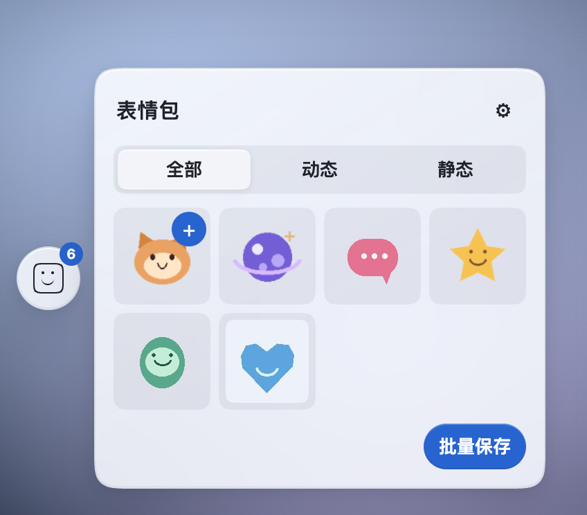

# 抖音表情包提取助手

[English](README.md)

适用于桌面 Chrome 和 Tampermonkey 的油猴脚本，用于保存抖音网页评论和私信中已显示的表情。**5.1.0** 提供可拖动的悬浮球与紧凑的表情网格。

*截图来自正式脚本在隔离 Chrome 演示页中的实际运行，使用自制表情。*

[查看放大预览截图](assets/sticker-preview.png)

## 功能

- 按动态、静态筛选，支持放大预览、单独保存和多选保存。
- 对相同文件及视觉相近的同款表情去重，优先保留合适的原生格式。
- 原生 GIF、PNG、JPEG 在适用时原样保存。动态 WebP 和 APNG 在浏览器内转 GIF，静态 WebP 转 PNG。
- 图片保存到你授权的文件夹，按动态和静态分类。也可在设置中下载 ZIP。
- 记住悬浮球的位置，并标记此前已保存的表情。

## 安装

1. 在 Chrome 中安装 [Tampermonkey](https://www.tampermonkey.net/) 扩展。若扩展详情提供 **允许用户脚本** 开关，请开启。若限制了扩展的网站访问权限，请允许访问抖音。 [Tampermonkey 权限说明](https://www.tampermonkey.net/faq.php?locale=en&q=Q209)
2. 在 GitHub 打开 [douyin-emoji-saver.user.js](douyin-emoji-saver.user.js) 的 **Raw** 链接，或在 Greasy Fork 发布页点击 **安装此脚本**，再在 Tampermonkey 中确认。
3. 刷新 [抖音](https://www.douyin.com/)。打开评论或选定的私信，点击悬浮球。点击表情可放大预览，多选后可批量保存。

保存授权、ZIP 下载、手动安装及故障排查见 [安装说明](docs/INSTALL.md)。

## 兼容与隐私

目前验收环境为桌面 Chrome 和 Tampermonkey。识别取决于抖音网页向当前会话提供的内容及页面结构。图片转换和去重在本地浏览器完成。 [隐私政策](PRIVACY.md)

[更新日志](CHANGELOG.md) · [发布验收记录](docs/VERIFICATION.md) · [第三方声明](THIRD-PARTY-NOTICES.md) · [许可证建议](LICENSE-PROPOSAL.md)

本项目是独立的抖音用户脚本。
